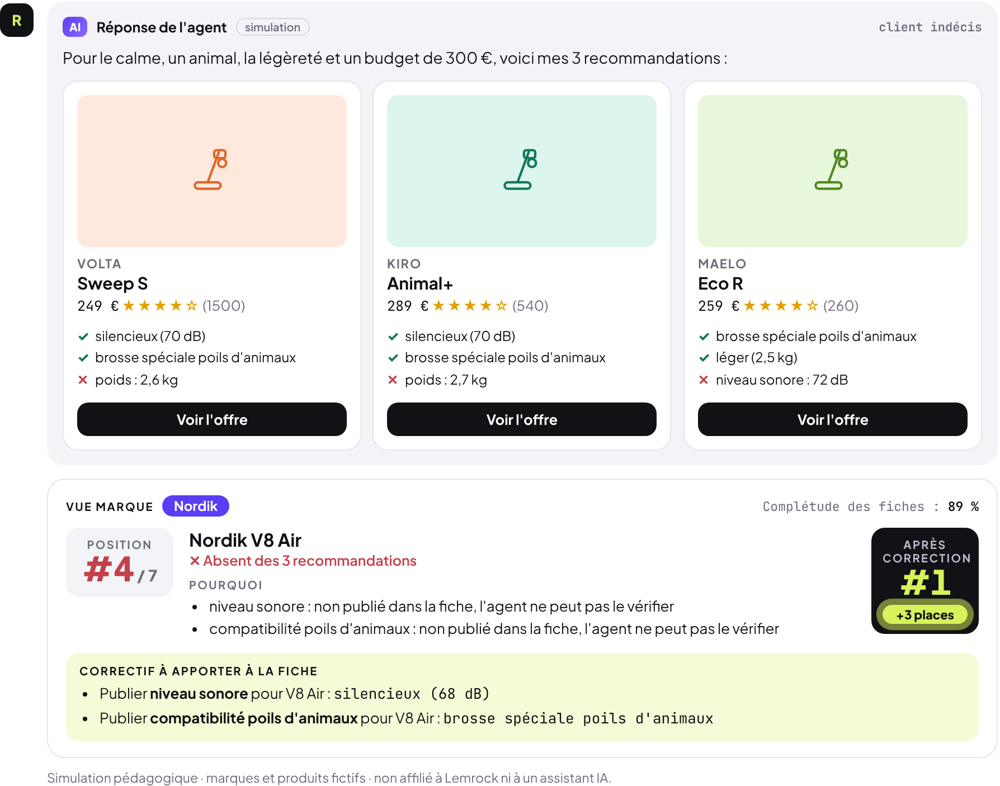
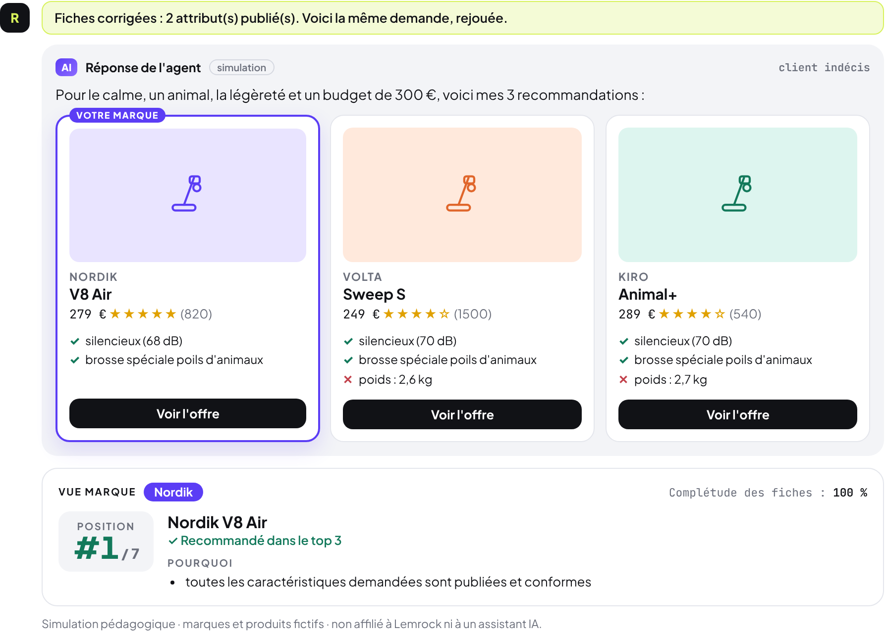
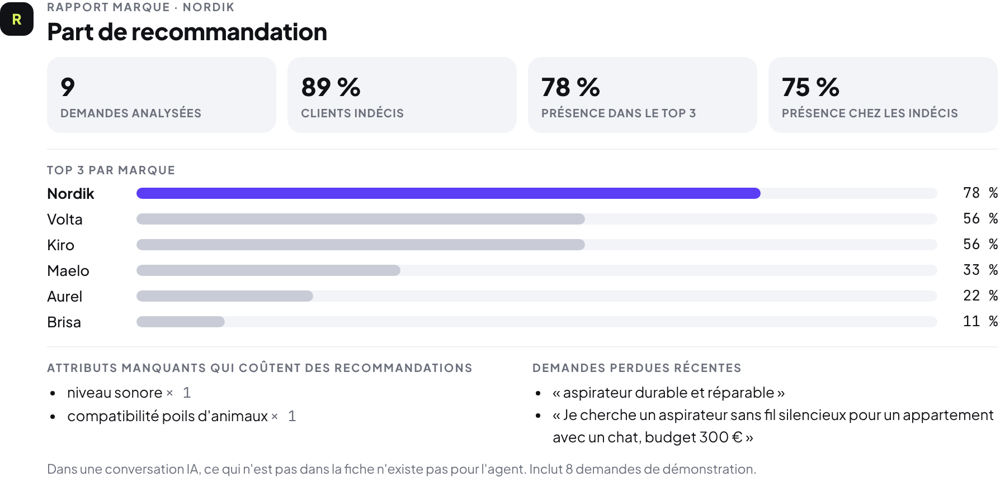

# Rayon

**An AI-shelf simulator for agentic commerce.**
A shopper asks an AI assistant for a product. Rayon shows what the agent would recommend, where your brand ranks, why it wins or loses, and what to fix in your product data to get recommended.

### ▶ [Try it live in your browser](https://anugrahasn1.github.io/rayon-agentic-shelf/)

## Why

Shoppers increasingly discover and choose products inside AI conversations. They describe a need ("quiet vacuum for a small flat with a cat"), not a keyword. The agent can only recommend what it can verify in the product data: an attribute that isn't published doesn't exist for the agent.

## What it does

> *"Je cherche un aspirateur sans fil silencieux pour un appartement avec un chat, budget 300 €"*

| | |
|---|---|
| **Reads the intent** | Category, budget, and needs (quiet, pets, lightness, battery, allergies, durability; noise cancelling, calls, sport; milk drinks, compact, easy cleaning…), in French or English. Flags whether the shopper is undecided or already names a brand |
| **Simulates the agent** | Ranks the catalogue on verified attributes, ratings and price, and answers with 3 product cards and the reasons for each |
| **Brand view** | Your best product's rank, why it lost (missing or failing attributes), the fix to make in the product data, and the rank after the fix |
| **Fixes the feed** | `corrige la fiche` / `fix the feed` publishes the missing attributes and replays the request (#4 → #1 in the demo) |
| **Brand report** | `rapport` / `report`: share of recommendation by brand, presence with undecided shoppers, attributes costing recommendations, recent lost requests |
| **Switch brand** | `marque Volta` / `brand Kiro` to see the shelf from another brand's side |

## Files

| File | Contents |
|---|---|
| `index.html` | The whole app, self-contained, served by GitHub Pages |
| `engine.js` | Catalogue, intent parsing, simulated agent, brand view, report, rendering |
| `build.py` | Builds `index.html` from `engine.js` |

## Honest limits

- **Brands and products are fictional** (Nordik, Volta, Kiro, Aurel, Brisa, Maelo), so no real company's data is misrepresented.
- The agent is a **transparent simulation**: it scores verified attributes, ratings, reviews and price. Real assistants use far richer signals; the point is the mechanism, not the exact ranking.
- The report starts with 8 demo requests so it isn't empty on first visit.

## About

Built by **Anugraha SN**, BBA student at EDHEC Business School.
Independent student prototype, not affiliated with Lemrock or any AI assistant.
